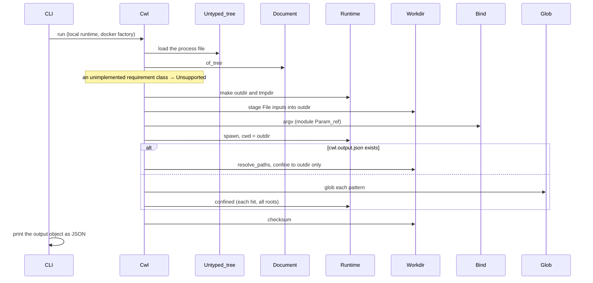

# Architecture

How ccr is built, for a reader who knows CWL v1.2 and the OCaml manual. ccr runs
a CommandLineTool on a job (an input object) and prints the output object as
JSON. Rules for changing the code are in `AGENTS.md`, setup and test commands in
`README.md`, the contract of each function in `lib/*.mli` and of each type in
`lib/data.ml`. Where this file and an `.mli` disagree, the `.mli` wins.

This file says what ccr does, not what the spec requires; where they differ the
spec wins. A failing case of the oracle suite (`test/oracle`, run by
`scripts/conformance.py --suite oracle`, results in
`_build/conformance/oracle.status`) marks a known difference from the spec or
from cwltool.

## Reading order

1. `README.md`, `AGENTS.md`, then this file.
2. `lib/data.ml`: every type and module signature (`FILE`, `FS`, `READ`,
   `WRITE`, `SPAWN`, `RUNTIME`, `ENGINE`). An `.mli` re-exports its part with
   `include module type of Data.X` and adds the functions.
3. `lib/cwl.mli`, then `lib/cwl.ml`: the helpers first, then `run`, which is
   one whole run from loading the tool to the checksums.
4. One module at a time, `.mli` first; its first paragraph says what the module
   is for and what it leaves out.

`bin/main.ml` is the command line and holds no CWL logic:

```text
ccr [--outdir DIR] [--quiet] [--rm-tmpdir | --leave-tmpdir] PROCESS [JOB]
```

It calls `Cwl.run` under `Eio_main.run` and prints the output object as JSON on
stdout. Without JOB the input object is empty. `--quiet` hides diagnostics, not
errors; `--version` and `--help` exit 0. The exit code is 33 for
`Error.Unsupported` and 1 for any other error, a usage error included. In
`lib/`, `(_, Error.t) result` values are sequenced with `let*` and `let+` from
`Error.Syntax`. The readers of a document return an `Error.Annotated.t`, which
also carries diagnostics, and combine with `let*`, `let+` and `and+` from
`Error.Annotated`.

## Names

- `Type` is the file `lib/ty.ml`: `Ty` inside `lib/`, `Cwl.Type` outside,
  `Data.Type` in `data.ml`. Every other module is named after its file.
- `lib/` builds two libraries. The core, `cwl`, has `Cwl` as its only public
  module: `cwl.mli` re-exports the others, and `Data` is a dune private module.
  `lib/cwl.ml` also holds the code that turns glob hits and `cwl.output.json`
  into output values. `runtime` is `lib/runtime.ml` alone, written against the
  core: `lib/dune` opens `Cwl` and `Cwl.Io` for it, so it says `Error` and
  `RUNTIME`, not `Cwl.Error` and `Cwl.Io.RUNTIME`.

## Layers

Derived from `ocamldep -modules lib/*.ml`. A module uses only lower layers.
`Data` (see Names) is below all of them and is not listed. Every listed module
but `Error` and `Io` uses `Error`, so the dependency lists leave `Error` out.

```text
0  Error
   Io
1  Location
2  Untyped_tree       Location
   Glob               Location
3  Ty                 Location, Untyped_tree
4  Schema             Ty, Untyped_tree
   Expr               Ty
   Workdir            Io, Location, Ty
5  Command_line_tool  Schema, Ty, Untyped_tree
   Workflow           Schema, Untyped_tree
6  Document           Command_line_tool, Workflow, Schema, Untyped_tree
   Bind               Command_line_tool, Expr, Schema, Ty
7  Cwl                all of the above
8  Runtime            Io, Location, Schema (library runtime)
```

Effects reach a function only as a module argument: `FILE` for
`Untyped_tree.load`, `FS` for `Glob.glob`, `READ` and `WRITE` for `Workdir`,
`RUNTIME` for `Cwl.run`, `ENGINE` for `Bind.argv`. Libraries outside `Stdlib`
appear in few places: `Yaml` in `Untyped_tree`, `Re` in `Glob`, `Digestif`,
`Unix`, `Eio`, `Eio_unix` and `Optint` in `Runtime`, `Cmdliner` and `Eio_main`
in `bin/main.ml`. Only `runtime` and `bin/` list Eio, Unix or digestif in
their dune `libraries`, so the compiler rejects them in the core. `Runtime`
implements `Glob.FS` and the `Io` signatures, and uses `Schema` for the Docker
settings.

## The run

`bin/main.ml` calls `Cwl.run` with `Runtime.local` and a factory that builds
`Runtime.docker` for a `DockerRequirement`.



What the diagram leaves out:

- **Directories.** The outdir is `--outdir` (made if missing) or a new `ccr-…`
  directory in the system temp directory, and is kept: it holds the outputs. The
  tmpdir is a new `ccr-tmp-…` directory (its `realpath`), the tool's `TMPDIR`,
  removed when the run ends, success or failure, unless `--leave-tmpdir`
  (cwltool's flag and default).
- **Inputs.** `Workdir.locate` turns each File and Directory `location` into
  an absolute host path: a job value's is taken from the job file's directory,
  and a default's from the tool's, as Process.yml resolves a relative reference
  against the document it appears in; a scheme other than `file` is
  `Error.Runtime`. `Type.apply_defaults_and_check` then
  fills missing or null inputs from their defaults and checks types
  (`Error.Missing`, `Error.Type`).
- **Staging.** `Workdir.stage` copies each File into the outdir under its
  basename. The copy's `path` is that basename, so the tool finds it from its
  working directory; its `location` is the path under the designated output
  directory. A File literal, with `contents` and neither `location` nor
  `path`, is written there instead, as `literal-<n>` when it has no basename.
  A Directory literal, with a `listing` and neither `location` nor `path`, is
  created there the same way, and its entries are staged into it, so their
  `path` is relative to the outdir too (`cwl/a.txt`).
  A File that is not a regular file once symlinks are followed and
  two Files with one basename in one directory are `Error.Runtime`. Any other
  Directory is not copied:
  its `path` and `location` stay the host path `Workdir.locate` gave it. Known differences from the spec or cwltool, each an
  oracle case: the `path` and `location` of a staged File, Files with one
  basename, and staged Files that a `glob` can match.
- **Argv.** `Bind.argv` follows the "Input binding" section of invocation.md: it
  sorts the bindings by `position` and builds each from `prefix`, `separate`,
  `itemSeparator` and `valueFrom`. A string in `arguments` is a binding whose
  `valueFrom` is that string, so a `$(...)` in it is evaluated. `Cwl.command_line` stops here, with placeholder
  `runtime.outdir` and `runtime.tmpdir` and without the requirement check, so
  argv tests start no process.
- **Streams.** `stdin`, `stdout` and `stderr` are expressions that name a file
  in the outdir, so `stdin` can be a staged input's `path`. An output of type
  `stdout` or `stderr` with no named stream uses `cwl.stdout` or `cwl.stderr`.
  The tool's stdout or stderr with no file goes to ccr's stderr, and an unnamed
  stdin reads `/dev/null`, so ccr's stdout carries only the JSON.
- **Spawn.** The tool starts in the designated output directory. It gets `HOME`
  (that directory), `TMPDIR` and, when local, ccr's `PATH`. An exit code outside
  `successCodes` (default `[0]`), or death by signal, is `Error.Runtime`;
  `temporaryFailCodes` and `permanentFailCodes` are diagnostics.
- **Outputs from `cwl.output.json`.** That object is the result and
  `outputBinding` is ignored. `Workdir.resolve_paths` makes its paths absolute
  (`file://` stripped, container paths relocated, relative ones taken from the
  outdir). A declared output that is missing becomes `null` if optional, `[]` if
  an array, else `Error.Runtime`. A present one must satisfy `Type.matches`
  (`Error.Type`). Other keys are kept.
- **Outputs by glob.** Each output is globbed with its `glob` patterns or, for
  type `stdout` or `stderr`, with the stream's file name taken as a pattern.
  Hits are merged, sorted and made unique. A File type with a Directory hit, or
  the reverse, is `Error.Type`. A File or Directory output takes exactly one
  hit: none gives `null` if it is optional and `Error.Runtime` if not, several
  give `Error.Runtime`. An array takes any number, none giving `[]`. An optional
  array (`File[]?`) is handled like an optional File: one hit gives a File and
  several give `Error.Runtime`. An output with no `glob` is `null` if optional,
  `[]` if an array, else `Error.Runtime`. `secondaryFiles` is a diagnostic. A
  Directory hit gets its `listing`, read through `Io.READ.read_dir`: every
  entry, dot names included, sorted by name, each subdirectory listed in turn
  (the spec leaves the depth open; cwltool lists the whole tree). Each entry is
  confined like a hit, and more than 64 levels is `Error.Runtime`.
- **Expressions.** `Expr.Param_ref` evaluates `position`, `valueFrom`, stream
  names and `glob`. A string that is one `$(…)` reference keeps the value's
  type. A string that mixes text and references is interpolated; `\$(`, `\${`
  and `\\` are escapes. A reference that does not resolve is `Error.Expr`.
  Beyond parameter references, `${…}` or a `$(…)` that is not a reference is
  `Error.Unsupported` with feature `InlineJavascriptRequirement`.
  `runtime.cores` is `coresMin` of a `ResourceRequirement` in `requirements`,
  else in `hints`, else 1 (a `coresMin` that is not a number is ignored);
  `runtime.ram` is always 256.
- **Output JSON.** `Type.to_json` prints it; there is no JSON library.
  Every File has `location` (`file://` and the path), `path`, `basename`,
  `nameroot` and `nameext` (`basename` split at its last dot; `nameext` is empty
  with no dot or only a leading one), `checksum` (`sha1$` and the hex from
  `Io.READ.sha1`) and `size`, also inside a `listing`; a Directory has
  `location`, `path` and `basename`. Every other field a File or Directory was given, such as
  `format` or `secondaryFiles` in `cwl.output.json`, prints as it was given.
  No outputs print `{}`.

**Why Eio.** `Unix.create_process` has no working-directory argument and
`Unix.chdir` changes the whole process, which would race between fibers; Eio's
`spawn ~cwd` sets the directory in the child. Calls Eio has no operation for
(`realpath`, temporary names, SHA-1) run through `Eio_unix.run_in_systhread`.

## Loading a document

`Cwl.run` splits a fragment off the process path at its last `#`, as in
`tool.cwl#id`, unless that leaves either part empty. Three steps load the
process. The job file goes through step 1 only, then `Type.object_of_tree`; it
is not a `Document`.

1. `Untyped_tree.load` reads the file through the `FILE` module it is given and
   parses it as YAML (JSON is YAML). A node with `$import` is replaced by the
   parsed content of that file, one with `$include` by its text. Relative paths
   resolve against `$base`, else the importing file's directory. Paths are
   local or `file://`: an `http` or `https` one is `Unsupported`, and a file
   that imports itself, directly or not, is a schema error.
2. `Document.of_tree` picks the process. In a `$graph`, or a document that is
   itself a list of processes, it is the entry whose `id` (ignoring everything
   up to its last `#`) is the fragment, or `main` without one; no such entry, or
   more than one, is a schema error. Any other document is the process itself
   and ignores the fragment. A `$graph` document's top-level `cwlVersion` is
   copied into an entry that lacks one. Then `class` decides: `CommandLineTool`
   and `Workflow` go to their parsers, a document with no `class` is read as a
   CommandLineTool, and any other class, such as `ExpressionTool`, is
   `Unsupported`.
3. `Command_line_tool.of_tree` or `Workflow.of_tree` reads the fields. Schema
   Salad's compact forms are expanded by hand: `T?` and `T[]` types, and
   `inputs`, `outputs`, `requirements` and `hints` given as a map keyed by id or
   class. `cwlVersion` must be `v1.0`, `v1.1` or `v1.2` and defaults to `v1.2`;
   ccr stores it and nothing depends on it.

## Docker

A `DockerRequirement` under `requirements` makes `Cwl.run` build its runtime
with the `?docker` factory it was given (the CLI passes `Runtime.docker`);
without one the run fails with `Error.Runtime`. Under `hints` it is still
parsed, so a malformed one is a schema error, but it is only a diagnostic and
the run stays local. Two in one list are a schema error.

- **Image source.** Exactly one of `dockerPull`, `dockerLoad`, `dockerImport`
  and `dockerFile` (the Dockerfile text); two or more are a schema error. With
  none of them, `dockerImageId` alone names an image used as is, and with
  neither it is a schema error. Each image field must be a non-empty string. A
  `dockerLoad` or `dockerImport` source is a local file or an `http(s)` URL
  (fetched with `curl`); a `.gz` or `.tgz` import is decompressed first.
- **`dockerImageId` beside a source.** Beside `dockerPull` it is ignored. Beside
  `dockerLoad`, `dockerImport` or `dockerFile` it is the name to run: import and
  build give the image that tag, and load takes it to be in the archive. Without
  it, load runs the name `docker load` reports (`Error.Runtime` if it reports
  none), and import and build tag the image `ccr:` and a hash of the
  `dockerImport` value or the Dockerfile text.
- **`dockerOutputDirectory`.** An absolute path in the container
  (`Schema.Container_outdir`, defined in `lib/data.ml`): not `/`, with no empty,
  `.` or `..` segment, no `:` (it would split the `-v` option) and no control
  character. It is the designated output directory: `runtime.outdir`, `HOME` and
  the working directory in the container. The host outdir, by its `realpath`, is
  bind-mounted there. A staged File's `location` is its path in the container
  and its `path` the basename. Glob patterns and `cwl.output.json` paths under
  it are relocated to the host outdir (a path with a `..` segment is not
  rewritten). When absent, the mount target is the host outdir's own path, which
  must then be absolute with no `.`, `..` or empty segment, else `Error.Runtime`
  (so a relative `--outdir` fails). A `:` in the host path is `Error.Runtime` in
  both cases.
- **Environment.** The `docker` client runs in `/` with ccr's environment, since
  its configuration lives under the invoking user's `HOME`. If `docker` is not
  on `PATH` but is in a known install location, ccr runs that file and puts its
  directory first on `PATH`. ccr sets only `HOME` and `TMPDIR` in the container
  (`--env`), which runs as ccr's `uid:gid`. The CWL argv follows the image name,
  so Docker runs it without a shell.
- **Mounts.** The outdir (at the designated output directory) and the tmpdir (at
  its own `realpath`). Directory inputs are not mounted.

## Confinement

The legal roots are the `realpath` of the outdir, the tmpdir and every located
Directory input's source. A path is under a root when it equals the root or starts with
the root and a `/`, so `/out-evil` is not under `/out` (`Location.under`). After
`Cwl.run` returns `Ok`, every File and Directory `path` and `location` in the
output object, declared outputs and extra `cwl.output.json` keys alike, resolves
with symlinks followed to a path under a legal root.

- **Glob.** `Glob.glob` lists only directories whose `realpath` is under a
  root; `Io.READ.confined` then checks each hit against all roots. A hit
  may be a symlink: it keeps its own path when its target is under a root and
  is `Error.Runtime` when not.
- **`cwl.output.json`.** `Workdir.confine` checks the `path` (the `location` if
  there is no `path`) against the outdir only, then sets both `path` and
  `location` to its `realpath`. A path that does not exist is `Error.Runtime`; a
  File whose path is not a regular file, or a Directory whose path is not a
  directory, is `Error.Type`.
- **Names and links.** `Workdir.safe_leaf` accepts a single path segment: not
  empty, not `.` or `..`, and containing none of slash, backslash, NUL. It
  checks staged File basenames and stream names. A `stdin`, `stdout` or
  `stderr` file that is already a symlink is `Error.Runtime`.

## Glob

`Glob.glob root pattern` lists what `pattern` matches under the directory `root`
(`Cwl` passes the outdir), reading the filesystem only through `Glob.FS`, which
`Runtime` implements. The spec asks for POSIX glob(3) matching relative to the
output directory. cwltool calls Python's `glob.glob` there. Like both, and
unlike bash, ccr does not expand `{a,b}`.

| Pattern | Behavior |
|---|---|
| `*` `?` `[…]` | Match inside one path component (`Re.Glob`). |
| leading `.` of a name | Matched only by a pattern component that itself starts with a literal `.`: `.*` matches `.hid`; `*`, `?hid` and `[.]hid` do not. |
| `{a,b}` | Not expanded; the braces are ordinary characters. |
| backslash | Dropped before matching; it does not make a following `*`, `?` or `[` literal. |
| `**` | As a whole component, zero or more directories, hidden ones included. Inside a longer component, as in `a**b`, it acts as `*`. |
| `..` | A `..` component anywhere is `Error.Runtime`. |
| starts with `/` | `Error.Runtime`, unless the pattern is `root` or starts with `root/`; the root prefix is then removed. |
| `.`, empty, `$(runtime.outdir)` | Root itself. |
| no match | `[]`; the caller decides whether that is an error. |

A walk of more than 64 directory levels is `Error.Runtime`.

## Extension points

Recipes for the changes made most often. Each names the functions to touch;
`AGENTS.md` says how to commit, test and measure them.

**Implement a field ccr already recognises** (one in the `~unimplemented`
list of a `Schema.diagnostics_for_keys` call):

1. Add it to its record in `lib/data.ml` (`Command_line_tool.t`,
   `Schema.input` or `Schema.output`, or `Type.binding`), named as the spec key
   in snake_case. The compiler then lists every literal that must set it,
   including `mk_tool`, `bound` and `binding` in `test/harness.ml` and
   `Ty.default_binding`.
2. Read it where its siblings are read (`Command_line_tool.of_tree`,
   `Schema.parse_input` or `parse_output`, `Schema.parse_binding`), as one more
   `and+` of the reader's `let+`: a scalar with `Untyped_tree.string_field`,
   `bool_field` or `int_field`, a sub-object with `Schema.field`. In the same
   commit, move its name from the `~unimplemented` list to the `~implemented`
   one; that is what silences its diagnostic.
3. Use it where the behavior lives: `Bind.argv` for the command line
   (`apply_value_from`, `generate_arg`), `Cwl.run` for the process and its
   streams, `collect_output` in `lib/cwl.ml` for outputs.
4. Pin it: a wrong-type row in `field_rows` (`test/test_import.ml`), the
   behavior as a `test/oracle` case quoting the spec, and a mutant.

**Add a requirement class:** a constructor of `Schema.requirement` in
`lib/data.ml`; an arm in `Schema.parse_requirement` before the catch-all that
makes a class `Unimplemented`, reading the fields with a function like
`parse_resource` that reports each field it doesn't implement as a diagnostic;
and the use in `Cwl.run` (from `requirements`, and from `hints` only where the
spec says so). Consumers match `Schema.requirement` with a wildcard, so search
for them (`rg 'Schema\.'`); the compiler won't list them. Flip any
`execute_edges` row that expected `Unsupported` for the class.

**Add a CWL-behavior test:** the tool (and job) under `test/oracle/`, and a case
in `test/oracle/tests.yaml` with exactly one authority. The format and the
authority rule are in `scripts/oracle.py`: `--check` checks the authorities,
`scripts/oracle.py <id>` seeds or records the expected output from cwltool.
Check a seeded output against the quoted spec sentence before committing it.

**Add an internal-contract test:** a property beside the module's others, or a
row in an existing table (`field_rows`, or `execute_edges` with a tool in
`test/fixtures/`). A new test module exports `tests` and is listed in the
`(modules ...)` of `test/dune` and in `test/test_cwl.ml`.

**Add a module:** `lib/<name>.ml` and `lib/<name>.mli`, the header in the
`.mli`; its types in a new submodule of `lib/data.ml`, with `include Data.<Name>`
in the `.ml` and `include module type of Data.<Name>` in the `.mli`; re-exported
in `lib/cwl.ml` and `lib/cwl.mli`. It does I/O only through the narrowest module
argument.

**Add a filesystem or process operation:** a `val` in `READ`, `WRITE` or `SPAWN`
(`Data.Io`), implemented once in `Runtime.filesystem`, which builds both
`Runtime.local` and `Runtime.docker` from a launcher. Callers take the narrowest
signature that has it.

**Add an expression engine:** a module with the `Expr.ENGINE` signature, passed
to `Bind.argv`. `Cwl` calls `Expr.Param_ref` itself for stream names and globs,
so those calls change too.

## Not built yet

A construct that ccr reads and does not implement becomes a diagnostic in the
parse result, so it is reported, not silently ignored. Inputs and outputs also
keep theirs in an `unimplemented` list, and a requirement class stays in the
record as `Schema.Unimplemented`. What it does to a run:

- A requirement class other than `ResourceRequirement` and `DockerRequirement`,
  under `requirements`, is `Error.Unsupported` (exit 33) before anything runs,
  even if the tool never uses it. Under `hints` it is a diagnostic.
- A field of an implemented construct (`ramMin`, `secondaryFiles`, `shellQuote`,
  `loadContents` on an input) is a diagnostic and the run goes on.
- `${…}`, a `$(…)` that is not a parameter reference, and an `outputEval` or
  `loadContents` beside a `glob` are `Unsupported` when reached.
- A Workflow parses, then is `Unsupported` when run; any other class is
  `Unsupported` when loaded.

Intended shape: JavaScript is a second `Expr.ENGINE`, and `outputEval` needs it.
A literal `InitialWorkDirRequirement` listing is `Runtime` work before the
spawn; a listing given as expressions needs JavaScript. A Workflow is a graph of
steps on the same Eio scheduler, each a run with its own outdir.

## Glossary

- **annotated**: `'a Error.annotated` is a result `value` with the `diagnostics`
  found while producing it. Parsers and `Cwl.run` return one.
- **designated output directory**: CWL's `runtime.outdir`, the tool's working
  directory and `HOME`. It is the outdir, except under Docker with
  `dockerOutputDirectory`: then it is the container path (`container` in `Cwl`).
- **diagnostic**: an `Error.diagnostic`, a construct that was read and not
  implemented. The CLI prints them on stderr after a successful run, unless
  `--quiet`.
- **ENGINE**: the signature of an expression evaluator. `Expr.Param_ref`, which
  handles parameter references only, is the one implementation.
- **item_binding**: the `inputBinding` of an array type's items, a field of
  `Type.Array`. A `Type.t` holds a binding, so the `binding` type is defined in
  `Type`, which `Schema` depends on, not in `Schema`.
- **json_path**: the dotted location of a node in the document, such as
  `inputs[0].type`; where a schema error or diagnostic points. Built with
  `Untyped_tree.child` and `Schema.nth`.
- **legal roots**: see Confinement. To confine a path is to check it against
  them after resolving symlinks (`Workdir.confine`, `Io.READ.confined`).
- **File, Directory**: a value (`Type.value`, the YAML/JSON tree) that is an
  object whose `class` is `File` or `Directory` (`Type.class_of`). It keeps
  every field it was given, in order; ccr reads and writes them with
  `Type.get`, `Type.get_string` and `Type.set`, and fills the ones the spec
  computes (`Type.fill_file_paths`).
- **location, path**: the two File and Directory fields. `location` says where
  the thing is, `path` where the tool opens it; each stands in for the other
  when missing (`Type.path`).
- **outdir**: the host directory where the tool runs and its outputs are
  collected.
- **relocate**: map a path under the designated output directory to the same
  place under the outdir (`Workdir.relocate`); other paths are unchanged.
- **requirement, hint**: CWL's `requirements`, which a runner must honor, and
  `hints`, which it may ignore. See Not built yet for what ccr does with each.
- **staging**: copying each File input into the outdir before the tool starts
  (`Workdir.stage`).
- **Unsupported**: `Error.Unsupported`, a feature the run needs and ccr lacks.
  The CLI exits 33.
